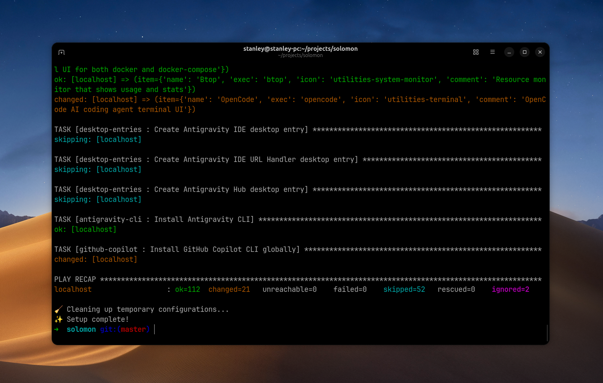

# 🌎 Genesis

This repository contains the **Ansible** configuration to automate the setup and maintenance of my personal computer, vps and more. The goal is to turn my machine configuration into "Infrastructure as Code" (IaC), allowing me to rebuild or sync my environment quickly and consistently.



## Compatibility

This project relies on `apt`, GNOME-specific tooling, and distro-specific package repositories, so it only supports:

| OS       | Minimum version           |
| :------- | :------------------------- |
| Ubuntu   | 22.04 LTS (Jammy) or newer |
| Debian   | 12 (Bookworm) or newer     |

Any other OS/distro (Fedora, Arch, macOS, WSL without a supported base, etc.) is **not supported**. `bootstrap.sh` validates the OS before making any changes and aborts with an error if it's incompatible.

## Quick Start (One-Liner)

To set up a fresh machine, just run:

```bash
# Interactive mode (opens checklist menu)
curl -sSL https://raw.githubusercontent.com/stanleygomes/genesis/refs/heads/master/bootstrap.sh | bash

# Non-interactive mode (specify playbooks to run)
curl -sSL https://raw.githubusercontent.com/stanleygomes/genesis/refs/heads/master/bootstrap.sh | bash -s -- minimal desktop
```

This command will install `git`, `ansible`, clone this repository, and run the setup.

---

## Manual Getting Started

### What does this project do?

- Manages system packages (Apt, Flatpak, Snap etc).
- Configures development environments (Node.js with pnpm, Java, Python, Go, Rust, PHP).
- Installs and configures AI tools (Antigravity CLI, Claude CLI, AI Memory etc).
- Setups CLI/TUI tools with desktop shortcuts (LazyDocker, etc).
- Customizes the shell and terminal (Zsh with Oh My Zsh, Bash, aliases, GNOME Terminal settings).

### Requisites

Before running the playbooks, you need to have **Ansible** installed on your machine. If you use `bootstrap.sh`, you don't need to install Ansible manually.

> [!NOTE]
> How to install: https://docs.ansible.com/projects/ansible/latest/installation_guide/intro_installation.html

## Usage

### 1. Bootstrap Script & Shell Command

The easiest way to set up or update the environment is running `bootstrap.sh`. It installs the system requirements, clones/pulls this repository, and runs the selected playbooks.

After the first run, the `zsh` role installs a `genesis` shell function in your `.zshrc`, allowing you to run it directly from any terminal.

#### Interactive Mode (Whiptail Menu)

Run without arguments to select playbooks interactively:

```bash
genesis update
```

#### Non-Interactive Mode (Direct Execution)

Pass one or more playbooks as arguments (or `all` to run everything):

```bash
# Run specific playbooks
genesis update minimal desktop
```

Run `diluvio` in a terminal to clean disposable system files and empty your local trash after confirmation. System cleanup requires sudo.

### 2. Manual Execution (via Makefile)

To run a specific configuration or multiple configurations:

```bash
make run CONFIG="minimal desktop"
```

### 3. Run in dry-run mode:

```bash
make check CONFIG="desktop"
```

### 4. Patmos (Isle fork) from a local checkout

The `patmos` role builds [Patmos](https://github.com/stanleygomes/patmos) (the owner's fork of Isle: `isled` daemon + GNOME Shell extension) from `~/projects/patmos` and installs it into `~/.local` with the fork's own `install.sh`. The official Isle `.deb` is purged by `autoremove`; settings (`dconf` `/org/gnome/shell/extensions/isle/`) and data (`~/.local/share/isle`) are kept.

```bash
# First time: installs build deps (sudo), purges the official .deb, installs the fork
make run CONFIG=desktop

# After each change in ~/projects/patmos (no sudo): rebuild + reinstall
make patmos            # skips when HEAD + uncommitted changes are unchanged
make patmos FORCE=1    # rebuild anyway
make patmos-check      # dry-run
```

`isled` restarts on reinstall; on Wayland, log out and back in to load the updated extension.

**Rollback to the official Isle:** remove the `patmos` role from `desktop.yml` and `isle` from `autoremove_apt_packages`, then reinstall upstream in `~/.local` (it overwrites the fork's files and keeps your settings):

```bash
curl -fsSL https://raw.githubusercontent.com/zickrian/isle/main/get.sh | bash
rm -f ~/.local/state/genesis/patmos.fingerprint
```

## Project Structure

```text
⚙️ ansible/            # Ansible configuration and deployment files
  ├── configs/         # Specific tool configurations (VS Code, agy, etc.)
  ├── group_vars/      # Global configuration variables (all.yml)
  ├── playbooks/       # Setup playbooks (minimal.yml, desktop.yml, custom1.yml)
  ├── roles/           # Modular Ansible roles (zsh, docker, etc.)
  ├── ansible.cfg      # Ansible configuration settings
  └── inventory        # Ansible host definition (localhost)
🛠️ Makefile            # Helper tasks to run, check, list playbooks
🐚 bootstrap.sh        # One-liner script to bootstrap environment (playbook selection via whiptail)
```

---

## 🧩 Available Roles

Here is a list of all roles available in this repository:

| Role              | Description                                                                                                                                                   |
| :---------------- | :------------------------------------------------------------------------------------------------------------------------------------------------------------ |
| `agents`          | Clones/updates the Solomon repo into `~/.config/solomon` and syncs its `.agents` (Skills, rules) into `~/.agents` and `~/.claude`. |
| `ai-memory`       | Installs `ai-memory` (akitaonrails/ai-memory) persistent cross-agent memory engine, systemd user service, and wires agent hooks/MCP. |
| `antigravity-cli` | Installs the Antigravity CLI client tool (`agy`) and configures custom statusLine settings. |
| `artcraft`       | Installs ArtCraft (AI crafting engine for artists) from the latest GitHub release `.deb`. |
| `atuin`           | Installs and configures Atuin shell history search.                                                                                                           |
| `autoremove`      | Aggregates uninstallation and removal actions (APT, Flatpak, Snap, and global NPM packages, systemd user services, GNOME Shell extensions, desktop shortcuts, and custom/user paths). |
| `bruno`           | Installs Bruno API client (open-source, Git-friendly alternative to Postman/Insomnia).                                                                        |
| `claude-cli`      | Installs Anthropic's Claude Code CLI (`claude`) via the official native installer and configures a custom statusLine. |
| `cli-tools`       | Installs everyday command-line packages from APT (`ffmpeg`, `rsync`; list in `defaults/main.yml`). |
| `dbeaver`         | Installs DBeaver Community Edition (SQL database explorer/client).                                                                                            |
| `diluvio`        | Installs a terminal command for confirmed cleanup of journal, APT cache, temporary files, and the local trash. |
| `docker`          | Installs Docker Engine, Docker Compose, and sets permissions/user groups.                                                                                     |
| `dust`           | Installs dust (a modern, intuitive version of du written in Rust).                                                                                            |
| `emulation`       | Installs RetroArch, PPSSPP and PCSX2 (Flatpak), the ES-DE game library frontend (AppImage) with RetroArch cores and per-console emulators preset, and sshfs to mount the Arkflix games. |
| `evangelist`      | Displays a random biblical verse on terminal session launch using local genesis files.                                       |
| `eza`            | Installs and configures eza (a modern, feature-rich replacement for ls).                                                                                      |
| `flameshot`       | Installs Flameshot screenshot tool and binds the Print Screen shortcut to it.                                                 |
| `gcloud-cli`      | Installs Google Cloud CLI (`gcloud`) from Google's official APT repository.                                                                                   |
| `ghostty`         | Installs Ghostty terminal emulator.                                                                                                                           |
| `git`             | Installs Git, configures user credentials, and generates/sets GitHub SSH keys.                                                                                |
| `github-cli`      | Installs GitHub CLI (`gh`) from GitHub's official APT repository.                                                                                              |
| `gnome_desktop`   | Consolidates GNOME desktop visual/UX setup: MacOS Dock extension (with Ubuntu Dock disabled and `gsettings` presets), Inter font (`fonts-inter`), WhiteSur icon theme, macOS cursor theme (`ful1e5/apple_cursor` + `~/.icons/default/index.theme` fallback), native `org.gnome.desktop.interface` settings (`accent-color`, fonts, icons, cursor, `enable-hot-corners`), and optional `Just Perfection` preferences (`startup-status`, `animation` when installed). |
| `go`              | Installs Go language runtime and `golangci-lint` to `~/.local/go`.                                                                                            |
| `google-chrome`   | Installs Google Chrome web browser.                                                                                                                           |
| `herdr`           | Installs Herdr terminal multiplexer for AI coding agents and configures default settings.                                                                      |
| `java`            | Installs SDKMAN and configures Java development dependencies.                                                                                                 |
| `mongodb-compass` | Installs MongoDB Compass GUI client.                                                                                                                          |
| `mongosh`         | Installs MongoDB Shell (`mongosh`) and configures `mongo-connect` credential management script.                                                               |
| `neovim`          | Installs latest Neovim editor via its official AppImage (including `libfuse2`), configuring it with `lazy.nvim` and plugins (Gruvbox, Telescope, Treesitter). |
| `nocturne`        | Installs Nocturne ambient sound and music player application via Flatpak.                                                                                     |
| `node`            | Installs NVM, Node.js runtime, and the `pnpm` package manager.                                                                                                |
| `openspec`        | Installs OpenSpec CLI (`@fission-ai/openspec`) globally via NPM.                                                                                              |
| `orca`            | Installs Orca via AppImage and clones or updates plugins in `~/.config/orca-plugins`, discarding tracked local changes. Links each Orca bot's `SOUL.md` to the matching folder in `~/.config/solomon/bots` (create the bot in Orca with that name first). |
| `oxker`           | Installs oxker TUI binary for Docker container monitoring and aliases `docker ps`.                                                                            |
| `patmos`          | Builds Patmos (Isle fork: `isled` + GNOME Shell extension) from `~/projects/patmos` and installs it in `~/.local`; rebuilds only when the checkout changes (`make patmos`). |
| `php`             | Installs PHP runtime, extensions, and Composer package manager.                                                                                               |
| `playwright`      | Installs Playwright's Chromium (browser + headless shell) for the user and its system libraries (`install-deps`). |
| `python`          | Installs Python runtime dependencies, Astral `uv` tool, and Python 3.14.                                                                                      |
| `rust`            | Installs the Rust toolchain (`stable`) via `rustup` in user space with `clippy` and `rustfmt`, and configures PATH in `~/.zshrc`.                             |
| `system`          | Installs GNOME Tweaks, Extension Manager and exiftool CR3 thumbnails for Nautilus.                                                                   |
| `starship`        | Installs and configures Starship prompt for Bash and Zsh.                                                                                                     |
| `terraform`       | Installs Terraform CLI tool from HashiCorp releases.                                                                                                          |
| `todoist-cli`     | Installs the official Todoist CLI (`td`, `@doist/todoist-cli`) globally via NPM (depends on `node`).                                                           |
| `tuicr`           | Installs tuicr (Terminal UI for Code Reviews).                                                                                                               |
| `vlc`             | Installs VLC media player (local media and network streams such as RTSP cameras).                                                                             |
| `vscode`          | Installs VS Code, syncs user settings/keybindings, and installs extensions.                                                                                   |
| `zellij`          | Installs Zellij terminal multiplexer binary and configures shell integration.                                                                                 |
| `zsh`             | Installs Zsh and Oh My Zsh, sets Zsh as default shell, and configures core aliases/functions.                                                                 |

---

## 📜 Playbooks & Mapped Roles

This project organises roles into the following playbooks:

### 1. Minimal Configuration (`minimal.yml`)

> Target: Lean workstation baseline — Git, GitHub CLI, Docker, Terraform, Google Cloud CLI, Todoist CLI, ffmpeg/rsync, Playwright Chromium, Zsh/Oh My Zsh, CLI tools, Neovim, Herdr, Zellij, Antigravity CLI, Claude CLI, AI Memory, the `diluvio` disk cleanup command, and the `evangelist` biblical verse display.

### 2. Desktop Configuration (`desktop.yml`)

> Target: User interfaces, consolidated GNOME desktop UX (`gnome_desktop`: MacOS Dock, Inter font, blue accent color, WhiteSur icon theme, macOS cursor theme, hot-corners disabled, and optional Just Perfection presets), web browsers, IDEs, ArtCraft, the VLC media player, game emulators (RetroArch, PPSSPP, PCSX2, ES-DE), desktop entries, agent configurations, language toolchains (Node.js, Java, Python, PHP, Go, Rust), Patmos (Isle fork built from `~/projects/patmos`), and database tools.

### 3. Custom Setup 1 (`custom1.yml`)

> Target: Custom bundle containing browsers, Bruno, databases, and Nocturne.

